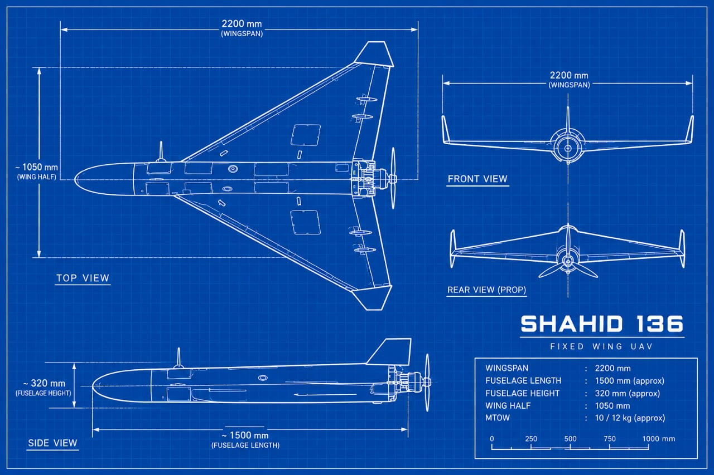

This technical blueprint diagram set against a classic blue grid background, detailing the schematic views and dimensions of the **Shahid 136 Fixed Wing UAV**. 
The layout features four distinct orthogonal views: a detailed **Top View** showcasing its delta-wing shape and central body, a **Side View** illustrating its streamlined profile and fuselage height, a **Front View** highlighting its wing span and vertical wingtip fins, and a **Rear View** displaying the rear pusher-propeller assembly.

In the lower right corner, a specification box and scale bar summarize key physical measurements for the drone. Listed dimensions include a **wingspan** of $2200 mm$, an approximate **fuselage length** of $1500 mm$, a **fuselage height** of approximately $320 mm$, a **wing half** dimension of $1050 mm$, and an estimated **Maximum Takeoff Weight (MTOW)** of $10 / 12 kg$.  

**Key Observations** 

* *Scaled-Down or RC Concept Design*: A standard real-world Shahed 136 is much larger, measuring roughly $3.5 m$ in length, $2.5 m$ in wingspan, and weighing around $200 kg$. In contrast, this blueprint lists an MTOW (Maximum Takeoff Weight) of only 10–12 kg with a 1.5 m length and 2.2 m wingspan.   

* *Enhanced Control Dynamics*: The smaller mass, combined with responsive control surfaces (like large elevons along the delta wing and dual vertical wingtip fins shown in the diagram), would allow for much faster pitch/roll rates and agile, smooth maneuvering compared to full-scale loitering munitions.

* *Agile Flight & Adaptive Pathing*: With a low-inertia 10–12 kg airframe, an adaptive motion planning system (such as real-time trajectory generation, obstacle avoidance, or dynamic waypointing) can execute tight, fluid turns and rapid evasive maneuvers that heavier fixed-wing drones simply cannot pull off.

<video src="https://github.com/adoni91/assets/Shahid 136 Fixed Wing UAV Demo.mp4" width="80%" controls></video>

That sounds like an exceptionally robust and advanced engineering setup! Combining a lightweight, agile delta-wing airframe with **PX4 Autopilot**, an **edge-AI companion computer**, and a **long-range communication link** creates a powerful platform for fully autonomous operations.

Here is how this architecture typically comes together for advanced UAV navigation:

### **1. Flight Control & Stabilization (PX4 Autopilot)**

* **Low-Level Execution:** PX4 handles the critical, high-frequency control loops, managing attitude stabilization, sensor fusion (IMU, GPS, compass), and motor outputs for the pusher-propeller.
* **Safety & Failsafes:** Provides reliable failsafe handling, return-to-home capabilities, and low-level stability even if higher-level systems experience brief dropouts.

### **2. Autonomous Perception & Decision-Making (Edge-AI)**

* **Onboard Processing:** Running machine learning models (such as object detection or neural networks) on an edge device (like a Jetson or specialized companion board) allows the UAV to process sensor data locally.
* **Real-Time Path Planning:** Enables dynamic trajectory generation, obstacle avoidance, and target tracking without needing a continuous, high-bandwidth connection to a ground station.

### **3. Long-Range Connectivity**

* **Telemetry & Mission Overrides:** Ensures stable, long-distance MAVLink communication for monitoring flight status, updating waypoints on the fly, or issuing manual overrides when necessary.
* **Data Logging & Transmission:** Passes critical situational awareness data back to the operator while keeping core autonomy decentralized.
